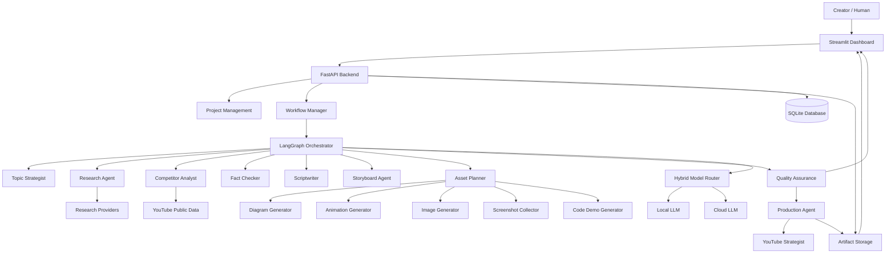
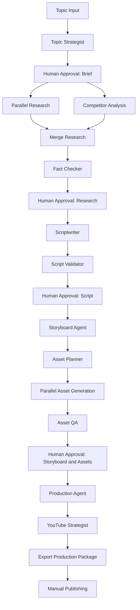
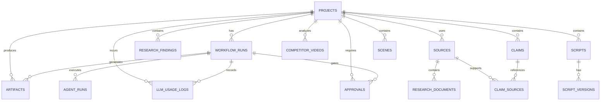

# Santosh Analytics AI Content Studio
## Project Plan

**Document:** `project_plan.md`  
**Project:** Santosh Analytics AI Content Studio  
**Version:** 1.1  
**Status:** Development – Milestone 4 Complete / Ready for Milestone 5  
**Architecture:** Local-first, modular monolith, hybrid AI  
**Primary interface:** Dashboard  
**Automation model:** Human-in-the-loop  
**Publishing:** Manual  

---

# 1. Project Overview

## 1.1 Vision

Build an agentic AI-powered content production platform for the **Santosh Analytics** YouTube channel.

The platform should take a video topic as input and coordinate specialized AI agents to research the topic, validate facts, analyze competing videos, generate scripts, create storyboards, produce visual assets, and prepare a complete YouTube production package.

The system should reduce manual content preparation while preserving human control over important creative and publishing decisions.

## 1.2 Primary Objectives

1. Automate topic research and content planning.
2. Identify relevant sources and maintain source traceability.
3. Analyze competing YouTube videos and content gaps.
4. Generate accurate, engaging, beginner-friendly scripts.
5. Generate scene-by-scene storyboards.
6. Create diagrams, animations, images, screenshots and code demonstrations.
7. Perform quality checks on generated content and assets.
8. Prepare production-ready content packages.
9. Maintain reusable channel guidelines and project history.
10. Support future expansion to cloud deployment.

## 1.3 Success Criteria

The platform should eventually be able to:

- Convert a topic into a structured content brief.
- Produce research findings with source references.
- Identify unsupported or questionable claims.
- Generate an editable video script.
- Create a storyboard with visual instructions.
- Generate or collect relevant visual assets.
- Generate executable code examples where appropriate.
- Export a complete production package.
- Resume interrupted workflows without losing completed work.
- Require human approval at defined checkpoints.

---

# 2. Channel Content Guidelines

All generated content must follow these channel-specific principles.

| Area | Requirement |
|---|---|
| Channel | Santosh Analytics |
| Audience | Beginners and intermediate technology learners |
| Language | Hinglish narration |
| Technical terminology | English |
| Explanation style | Simple sentences and practical examples |
| Presentation | Show face, supported by screen recordings and visuals |
| Topics | Analytics, Data Science, ML, GenAI, Agentic AI, MLOps, SQL and cloud |
| Visuals | Professional diagrams, animations, screenshots and code |
| Tutorial approach | Practical, step-by-step demonstrations |
| Description | Mention 8+ years of experience in the data field |
| Publishing | Manual review and upload |

These guidelines must be configurable rather than hardcoded into individual agents.

---

# 3. Functional Scope

## 3.1 Complete Feature List

| Module | Features | Priority |
|---|---|---|
| Project Management | Create, edit, archive and track content projects | P0 |
| Topic Strategy | Topic evaluation, audience analysis, content angle | P1 |
| Research | Web research, extraction, source management | P1 |
| Competitor Analysis | Video titles, descriptions, metadata and content gaps | P1 |
| Fact Checking | Claim extraction, evidence verification, risk detection | P1 |
| Scriptwriting | Structured Hinglish scripts and revisions | P1 |
| Storyboarding | Scene-level narration and visual instructions | P1 |
| Diagrams | Architecture diagrams, flowcharts and funnels | P2 |
| Animations | HTML/CSS/JS educational animations | P2 |
| Images | AI-generated illustrations and supporting visuals | P2 |
| Screenshots | Screenshot collection, annotations and highlights | P2 |
| Code Demos | Generate and validate executable code examples | P2 |
| Asset QA | Technical and content quality validation | P2 |
| Production | Production notes, editing instructions and export | P2 |
| YouTube Strategy | Titles, descriptions, tags and thumbnail concepts | P2 |
| Evaluation | Quality scoring, model usage and workflow monitoring | P3 |

P0 = Foundation, P1 = Core workflow, P2 = Production capabilities, P3 = Optimization.

## 3.2 Explicitly Out of Scope

The initial release will not:

- Automatically publish videos.
- Automatically upload thumbnails or descriptions.
- Automatically access private YouTube analytics.
- Generate fabricated screenshots or claim they are real.
- Present unsupported facts as verified information.
- Execute untrusted generated code directly on the host machine.
- Require paid cloud services for basic local development.

---

# 4. Technical Architecture

## 4.1 Architecture Principles

1. Local-first development.
2. Modular monolith instead of premature microservices.
3. Hybrid local and cloud model support.
4. Provider-independent interfaces.
5. Human approval for important decisions.
6. Persistent and resumable workflows.
7. Artifact files stored outside the database.
8. Structured data contracts between agents.
9. Testable deterministic services.
10. Future cloud deployment without major architectural changes.

## 4.2 Technology Stack

| Layer | Technology |
|---|---|
| Language | Python 3.12 |
| Dependency management | uv |
| Backend | FastAPI |
| Dashboard | Streamlit |
| Agent orchestration | LangGraph |
| Data validation | Pydantic |
| ORM | SQLAlchemy 2.x (async) |
| Database | SQLite via `aiosqlite` initially |
| Migrations | Alembic (async) |
| Workflow checkpointing | LangGraph SQLite checkpointer (`data/checkpoints.db`) |
| Path handling | `pathlib.Path` exclusively (never `os.path`) |
| Local LLM | Ollama |
| Cloud LLM | Configurable provider adapter |
| Model routing | Custom model router |
| Web research | Search provider adapter |
| Web extraction | Trafilatura |
| Diagram generation | Mermaid / SVG |
| Animation | HTML / CSS / JavaScript |
| Browser automation | Playwright, where authorized |
| Testing | Pytest |
| Code quality | Ruff |
| Artifact storage | Local filesystem |
| Version control | Git / GitHub |

### Model Strategy

Use a hybrid model architecture.

**Local models:**
- Ollama-compatible models for routine generation and private processing.
- Prefer models that fit available laptop resources.

**Cloud models:**
- Use configurable cloud APIs for complex reasoning, high-quality research synthesis and difficult generation tasks.
- Keep provider and model configuration outside agent implementations.

The application must continue to support local-only operation (`LOCAL_ONLY=true`, `MAX_BUDGET_USD=0.0`) when cloud credentials are unavailable. Cloud fallbacks must be explicitly enabled and bounded by per-project (`budget_usd` / `spent_usd`) and global budget caps.

## 4.3 High-Level Architecture



---

# 5. Application Modules

## 5.1 Project Management

Responsibilities:

- Create a content project.
- Store topic, category and target audience.
- Select content format and expected duration.
- Track workflow status.
- View generated artifacts.
- Resume incomplete projects.
- Maintain project history.

Each video idea should be represented by a separate project.

## 5.2 Research Engine

Responsibilities:

- Search relevant web sources.
- Extract webpage content.
- Store source metadata.
- Extract important facts and concepts.
- Identify technical definitions and examples.
- Identify contradictory information.
- Maintain source-to-claim traceability.

Every research finding should include source references and retrieval metadata.

## 5.3 Competitor Analysis

Analyze publicly accessible YouTube information.

Capture:

- Video title.
- Channel name.
- Video URL.
- Publication date, when available.
- Duration, when available.
- Public view and engagement metadata, when available.
- Description.
- Topic coverage.
- Content gaps.
- Potential opportunities for differentiation.

Do not invent video performance metrics or assume public metadata represents private channel analytics.

## 5.4 Script Generation

The script should contain:

1. Hook.
2. Introduction.
3. Problem statement.
4. Learning objectives.
5. Main explanation.
6. Practical demonstration.
7. Examples.
8. Summary.
9. Call to action.

For each section, store:

- Narration.
- Visual instructions.
- Screen-recording requirements.
- Code demonstration references.
- Estimated duration.
- Source references, where applicable.

Scripts must support revisions and version history.

## 5.5 Storyboard Generation

Each scene should include:

- Scene number.
- Scene title.
- Estimated duration.
- Narration.
- On-screen text.
- Visual type.
- Asset requirements.
- Camera or screen-recording instructions.
- Transition instructions.
- Related script section.

## 5.6 Asset Generation

The platform must support five primary asset categories.

**A. Diagrams**
- Architecture diagrams.
- Process flowcharts.
- Data pipelines.
- Comparison diagrams.
- Funnels.
- Concept illustrations.

**B. Animations**
- HTML/CSS/JS animations.
- Animated workflows.
- Step-by-step technical explanations.
- Interactive demonstrations.

**C. Images**
- Supporting illustrations.
- Concept visuals.
- Backgrounds and thumbnails concepts.

**D. Screenshots**
- User-provided screenshots.
- Authorized browser captures.
- Highlighted UI elements.
- Zoomed areas and annotations.

**E. Code**
- Python examples.
- SQL queries.
- API examples.
- ML demonstrations.
- Runnable project examples.

Every generated asset must have metadata, a file path, version and QA status.

---

# 6. Agent Specifications

Agents should have narrowly defined responsibilities and communicate using Pydantic schemas.

| Agent | Responsibility | Expected Output |
|---|---|---|
| Topic Strategist | Define content angle and audience | ContentBrief |
| Research Agent | Research topic and extract findings | ResearchReport |
| Competitor Analyst | Analyze competing videos | CompetitorReport |
| Fact Checker | Verify claims and flag uncertainty | FactCheckReport |
| Scriptwriter | Generate narration | Script |
| Storyboard Agent | Convert script into scenes | Storyboard |
| Asset Planner | Determine required visual assets | AssetPlan |
| Diagram Generator | Create diagrams | DiagramAsset |
| Animation Generator | Create HTML animations | AnimationAsset |
| Image Generator | Create illustrations | ImageAsset |
| Screenshot Collector | Capture authorized screenshots | ScreenshotAsset |
| Code Demo Generator | Generate and validate code | CodeDemoAsset |
| Asset QA | Validate generated assets | AssetQAReport |
| Production Agent | Prepare production package | ProductionPackage |
| YouTube Strategist | Generate metadata and packaging ideas | YouTubeMetadata |

## 6.1 Agent Design Rules

Every agent must have:

- A defined input schema.
- A defined output schema.
- A clear system prompt.
- A configurable model.
- A timeout.
- Retry rules.
- Error handling.
- Logging and usage tracking.
- Unit tests.
- Evaluation criteria.

Do not create an agent for every small operation. Use deterministic services for file handling, webpage extraction, diagram rendering, validation and export.

---

# 7. LangGraph Workflow

## 7.1 Main Workflow



## 7.2 Human Approval Gates

| Gate | Approval Required |
|---|---|
| Gate 1 | Content brief |
| Gate 2 | Research and fact-check report |
| Gate 3 | Script |
| Gate 4 | Storyboard and assets |
| Gate 5 | Final production package |

Users must be able to:

- Approve.
- Reject.
- Request changes.
- Add comments.
- Resume the workflow.

## 7.3 Workflow Engineering Requirements

- Use persistent LangGraph checkpoints.
- Assign a stable thread ID to each project workflow.
- Support pause and resume.
- Keep large binary assets outside graph state.
- Store artifact references and metadata in graph state.
- Implement idempotent asset-generation operations.
- Prevent duplicate work after retries.
- Record node execution status and errors.
- Support cancellation and recovery.
- Store model usage and execution duration.

---

# 8. Database Design

Use SQLite initially via `aiosqlite` with async SQLAlchemy 2.x and Alembic migrations. Introduce domain tables incrementally in the milestone where their Pydantic contracts are finalized to avoid premature schema drift.

## 8.1 Core Tables

| Table | Purpose | Milestone |
|---|---|---|
| `projects` | Video content projects, status, config, and budget tracking | M1 (Implemented) |
| `workflow_runs` | Workflow execution records and LangGraph `thread_id` tracking | M1 (Implemented) |
| `artifacts` | Versioned artifact metadata, relative paths, status, and SHA-256 checksums | M1 (Implemented) |
| `llm_usage_logs` | Token, cost, and latency tracking per node/provider/model | M1 (Implemented) |
| `approvals` | Human approval gate records, decisions, and reviewer comments | M2 (Implemented) |
| `channel_guidelines` | Reusable, configurable channel preferences and brand rules | M2 (Implemented) |
| `agent_runs` | Per-agent/node execution audit trail linked to `workflow_runs` | M2 (Implemented) |
| `sources` | Research source metadata and deduplication keys | M4 (Implemented) |
| `research_documents` | Extracted webpage content metadata / references | M4 (Implemented) |
| `research_findings` | Structured research findings linked to sources | M4 (Implemented) |
| `claims` | Factual claims requiring verification | M5 |
| `claim_sources` | Claim-to-source evidence mapping | M5 |
| `competitor_videos` | Public YouTube competitor metadata and content-gap notes | M5 |
| `scripts` | Script logical records per project | M6 |
| `script_versions` | Script revision history and approval linkage | M6 |
| `scenes` | Storyboard scenes and scene-level visual/asset requirements | M6 |

## 8.2 Entity Relationships



## 8.3 Database Standards

- Use UUID primary keys.
- Store timestamps in UTC.
- Use timezone-aware datetime values.
- Define foreign keys and indexes.
- Use JSON only for flexible metadata.
- Store file contents outside the database.
- Maintain artifact checksums.
- Track created_at and updated_at.
- Use Alembic for all schema changes.
- Avoid automatic table creation at application startup.

---

# 9. Repository Structure

```text
santosh-ai-content-studio/
│
├── AGENTS.md
├── project_plan.md
├── README.md
├── pyproject.toml
├── uv.lock
├── .python-version
├── .env.example
├── .gitignore
├── alembic.ini
│
├── alembic/
│   ├── env.py
│   └── versions/
│       └── 0001_initial_schema.py
│
├── app/
│   ├── main.py
│   ├── dependencies.py
│   └── api/
│       ├── routes/
│       └── schemas/
│
├── frontend/
│   ├── Home.py
│   ├── api_client.py
│   └── pages/                     # Added incrementally (Workspace, Approvals, Settings)
│
├── src/
│   └── content_studio/
│       ├── config/
│       ├── contracts/             # Domain Pydantic models shared across layers
│       ├── database/
│       │   ├── models/
│       │   ├── repositories/
│       │   └── session.py
│       ├── storage/               # Filesystem ArtifactStore (pathlib.Path)
│       ├── services/              # Added in M2+ (ArtifactService, Guidelines, etc.)
│       ├── providers/             # Added in M3+ (llm, search, youtube, image)
│       ├── agents/                # Added in M4+
│       ├── workflows/             # Added in M7 (graphs, nodes, state)
│       ├── evaluation/            # Added in M10
│       └── utils/
│
├── prompts/                       # Added in M4+ (versioned prompt templates)
├── templates/                     # Added in M8+ (HTML animations, export templates)
├── tests/
├── docs/                          # Optional ADRs and operational docs
└── data/                          # Gitignored runtime DB, checkpoints, and project artifacts
    ├── content_studio.db
    ├── checkpoints.db
    └── projects/
```

Keep generated content, credentials, databases and other runtime files out of Git.

---

# 10. Dashboard Design

The Streamlit dashboard should provide the following sections.

## 10.1 Home

- Total projects.
- Projects in progress.
- Projects awaiting approval.
- Completed projects.
- Recent activity.
- Model usage summary.

## 10.2 New Project

Inputs:

- Video topic.
- Category.
- Target audience.
- Expected duration.
- Content format.
- Technical depth.
- Optional reference links.
- Additional instructions.

## 10.3 Project Workspace

Tabs:

1. Overview
2. Research
3. Competitor Analysis
4. Fact Checking
5. Script
6. Storyboard
7. Assets
8. Production
9. Workflow History

## 10.4 Approval Center

Display pending approval requests.

For every approval:

- Show generated content.
- Show comments.
- Allow revisions.
- Approve or reject.
- Resume workflow.

## 10.5 Settings

- Local model configuration.
- Cloud model configuration.
- Search provider configuration.
- Model routing rules.
- Channel guidelines.
- Artifact storage configuration.

---

# 11. Artifact Management

Use filesystem storage (`ArtifactStore` with `pathlib.Path`, atomic writes, and SHA-256 checksums) for actual files and database records (`artifacts` table) for metadata.

Stage-based project directory structure (scaffolded automatically on project creation):

```text
data/projects/{project_id}/
│
├── 01_research/
│   ├── sources/
│   ├── findings/
│   ├── competitors/
│   └── fact_check/
│
├── 02_outline/                    # Content brief & storyboard scenes
├── 03_script/                     # Draft and approved script versions
├── 04_visuals/
│   ├── diagrams/
│   ├── animations/
│   ├── images/
│   └── screenshots/
│
├── 05_demos/                      # Validated executable code demos
└── 06_export/                     # Production notes, YouTube metadata & ZIP bundle
```

Each artifact should record:

- Artifact ID.
- Project ID.
- Type.
- File path.
- Version.
- Status.
- Checksum.
- Generator agent.
- Model/provider, if applicable.
- Creation timestamp.
- Related scene or script section.

---

# 12. Development Roadmap

The implementation is divided into ten milestones.

## Milestone 1 – Foundation

**Goal:** Establish a working application skeleton.

Tasks:

- [x] Initialize repository scaffold.
- [x] Configure Python 3.12 and uv.
- [x] Add FastAPI application.
- [x] Add Streamlit dashboard skeleton (`frontend/Home.py`).
- [x] Add initial database models (`projects`, `workflow_runs`, `artifacts`, `llm_usage_logs`), repositories, and `ArtifactStore`.
- [x] Add project CRUD API and Pydantic contracts.
- [x] Add Alembic async configuration and `0001_initial_schema.py` migration.
- [x] Remove automatic `create_all` table creation from FastAPI startup (enforce Alembic-only migrations).
- [x] Format codebase and verify Ruff lint & format checks.
- [x] Populate `README.md` and configure local `.env`.
- [x] Run initial database migration (`uv run alembic upgrade head`).
- [x] Verify FastAPI backend (`/health`, `/docs`, `/api/projects`) and Streamlit dashboard startup.
- [x] Run full Pytest suite and verify passing tests.
- [x] Configure Git and create initial commit.

**Acceptance criteria:**

- Application starts locally.
- API health endpoint works.
- Dashboard opens.
- Project CRUD, repository, and artifact store tests pass.
- Alembic database migration applies cleanly.
- Ruff lint and format checks pass.

## Milestone 2 – Shared Persistence and Artifact Management

Tasks:

- [x] Add shared operational entities (`approvals`, `channel_guidelines`, `agent_runs`) and Alembic migration `0002_shared_persistence.py`.
- [x] Add repositories and Pydantic schemas for approvals, channel guidelines, and agent runs.
- [x] Build `ArtifactService` coordinating `ArtifactStore` (filesystem) and `ArtifactRepository` (DB metadata + SHA-256 checksums + versioning + superseding).
- [x] Add project artifacts API (`/api/projects/{project_id}/artifacts`), channel guidelines API (`/api/guidelines`), and approvals API (`/api/approvals`).
- [x] Add Project Workspace and Settings pages in Streamlit (`frontend/pages/`) with project-level artifact browsing, checksum verification, approvals, and channel guidelines editor.
- [x] Add database, migration roundtrip, service, and API integration tests.

**Acceptance criteria:**

- Projects, approvals, channel guidelines, agent runs, and artifact metadata persist cleanly via Alembic migrations.
- Artifacts are saved atomically outside the database with verified SHA-256 checksums and version history.
- Project artifacts can be listed, inspected, and downloaded/viewed via API and Streamlit workspace.
- Database migrations upgrade and downgrade reliably.

## Milestone 3 – Hybrid LLM and Provider Layer

Tasks:

- [x] Define common LLM provider interface (`BaseLLMProvider`, typed `LLMRequest`/`LLMResponse`/`LLMUsage`).
- [x] Implement Ollama provider (`OllamaProvider` via async `httpx` `/api/chat` and `/api/tags`).
- [x] Implement configurable cloud provider (`GeminiProvider` via REST API with header-based auth).
- [x] Add `ModelRouter` with task-based routing (`TaskType`), local-only enforcement, and global/per-project budget caps.
- [x] Add timeout, bounded exponential-backoff retries, and graceful cloud-outage fallback to local Ollama.
- [x] Add strict Pydantic structured-output extraction, validation, and bounded repair turns (`generate_structured`).
- [x] Record token usage, latency, and estimated cost in `llm_usage_logs` and update `projects.spent_usd`.
- [x] Expose `/api/llm/status` and `/api/projects/{project_id}/usage` endpoints + Settings UI provider health view.
- [x] Test local-only mode, cloud fallback, budget caps, retries, structured repairs, and API routes.

**Acceptance criteria:**

- Agents do not directly depend on a specific provider.
- Local and cloud providers can be switched through configuration.
- Invalid model outputs are handled safely.

## Milestone 4 – Research Engine

Tasks:

- [x] Add research tables (`sources`, `research_documents`, `research_findings`) via Alembic migration `0003_research_engine.py`.
- [x] Implement search provider interface (`BaseSearchProvider`, zero-key `DuckDuckGoSearchProvider`, optional `TavilySearchProvider`).
- [x] Implement async webpage extraction (`WebExtractor` using `trafilatura` with HTML fallback and error recording).
- [x] Store source metadata and full extracted text outside DB in `01_research/sources/`.
- [x] Build URL canonicalization (`url_hash`) and content-checksum (`content_checksum_sha256`) deduplication.
- [x] Implement structured `ResearchReport` / `ResearchSynthesisOutput` Pydantic contracts and externalized prompt templates (`prompts/research/`).
- [x] Enforce strict source traceability (strip fabricated URLs and drop ungrounded findings) and save versioned report artifacts (`research_report.json`, `research_report.md`).
- [x] Add Research API (`/api/projects/{project_id}/research/...`) and Research tab in Streamlit Project Workspace.

**Acceptance criteria:**

- A topic produces a structured research report.
- Every finding retains its source references.
- Extraction errors are recorded.
- Duplicate sources are handled.

## Milestone 5 – Fact Checking and Competitor Analysis

Tasks:

- Add fact-check and competitor tables (`claims`, `claim_sources`, `competitor_videos`) via Alembic migration.
- Implement claim extraction.
- Implement claim-to-source mapping.
- Build evidence-based fact checker.
- Classify verified, unsupported, conflicting and uncertain claims.
- Implement public YouTube metadata collection.
- Analyze competing video topics.
- Generate content-gap reports.
- Persist research approval gate records and expose review UI in Approval Center (full graph interrupt/resume wired in Milestone 7).

**Acceptance criteria:**

- Claims can be traced to supporting evidence.
- Unsupported claims are clearly flagged.
- Competitor data is sourced.
- Research approval decisions and comments are persisted and block progression until approved.

## Milestone 6 – Scriptwriting and Storyboarding

Tasks:

- Add script and storyboard tables (`scripts`, `script_versions`, `scenes`) via Alembic migration.
- Wire `channel_guidelines` into scriptwriter prompt context.
- Build scriptwriter agent.
- Implement structured script output.
- Add script revisions and versioning.
- Build script validation.
- Build storyboard agent.
- Generate scene-level asset requirements.
- Persist script approval decisions and expose review UI in Approval Center (full graph interrupt/resume wired in Milestone 7).

**Acceptance criteria:**

- A research report produces an editable script.
- Script follows channel guidelines.
- Script versions are preserved.
- Approved scripts can proceed to storyboarding.

## Milestone 7 – LangGraph Orchestration

Tasks:

- Define graph state.
- Implement workflow nodes.
- Implement conditional edges.
- Add parallel research execution.
- Add persistent checkpointing.
- Implement human approval interrupts.
- Add retry and recovery logic.
- Implement workflow history.
- Add integration tests.

**Acceptance criteria:**

- Full workflow can execute from topic to script.
- Human approvals work.
- Interrupted workflows can resume.
- Completed tasks are not unnecessarily repeated.

## Milestone 8 – Visual Asset Generation

Tasks:

- Implement asset planner.
- Implement Mermaid diagram generation.
- Implement SVG rendering.
- Implement HTML animation templates.
- Integrate image provider.
- Implement authorized screenshot capture.
- Implement screenshot annotations.
- Implement code demo generation.
- Build isolated code execution.
- Implement asset QA.

**Acceptance criteria:**

- Assets are associated with storyboard scenes.
- Assets have version history.
- Code demonstrations pass validation before approval.
- Screenshots have clear provenance.
- Failed asset generation can be retried independently.

## Milestone 9 – Production Package and YouTube Strategy

Tasks:

- Build production agent.
- Generate editing instructions.
- Generate scene sequence.
- Generate asset manifest.
- Generate title options.
- Generate descriptions.
- Generate thumbnail concepts.
- Generate chapter suggestions.
- Generate tags and supporting metadata.
- Build ZIP export.

**Acceptance criteria:**

- A project can be exported as a complete production package.
- Export includes scripts, storyboard, assets and metadata.
- No automatic publishing takes place.

## Milestone 10 – Evaluation and Hardening

Tasks:

- Build agent evaluation framework.
- Create representative test projects.
- Evaluate factual accuracy.
- Evaluate source quality.
- Evaluate script quality.
- Evaluate asset quality.
- Measure model latency and cost.
- Add structured logs.
- Improve exception handling.
- Test larger projects.
- Document deployment and backup procedures.

**Acceptance criteria:**

- Critical workflow tests pass.
- Quality evaluation is repeatable.
- Failures are observable.
- Project data can be backed up and restored.
- Application is ready for broader usage.

---

# 13. Quality Evaluation Framework

Use a configurable evaluation framework.

Initial evaluation dimensions:

| Dimension | Weight |
|---|---:|
| Factual accuracy | 25% |
| Research quality | 15% |
| Script quality | 20% |
| Teaching clarity | 15% |
| Visual relevance | 10% |
| Channel guideline compliance | 10% |
| Production readiness | 5% |
| **Total** | **100%** |

These are initial weights, not objectively established quality scores.

Every evaluation should record:

- Evaluator.
- Model.
- Evaluation prompt version.
- Individual dimension scores.
- Overall score.
- Feedback.
- Evaluation timestamp.

Human review remains mandatory regardless of the score.

---

# 14. Security and Reliability

## 14.1 Security

- Store API keys in environment variables.
- Never commit `.env`.
- Validate uploaded files.
- Restrict artifact paths to the project storage directory.
- Apply timeouts to external requests.
- Sanitize generated HTML.
- Execute generated code in an isolated environment.
- Limit execution time, memory and filesystem access.
- Do not expose internal credentials to agents.
- Treat external webpage content as untrusted input.

## 14.2 Reliability

- Implement retries with bounded attempts.
- Maintain workflow execution logs.
- Use persistent checkpoints.
- Support resuming interrupted workflows.
- Implement idempotency keys for generation operations.
- Store artifact checksums.
- Avoid destructive updates to approved content.
- Maintain version history.
- Handle provider outages gracefully.

---

# 15. Testing Strategy

| Test Type | Coverage |
|---|---|
| Unit tests | Schemas, repositories, services and utilities |
| Integration tests | Database, API and providers |
| Workflow tests | LangGraph execution and resume |
| Agent tests | Structured input/output and prompt behavior |
| Evaluation tests | Factuality, clarity and guideline compliance |
| UI tests | Dashboard navigation and approval actions |
| Security tests | Upload validation and code isolation |
| Regression tests | Previously approved project examples |

External API tests should support mocks so that routine tests do not require paid API calls.

---

# 16. Configuration

Use environment-based configuration.

Example `.env.example`:

```env
APP_ENV=development
LOG_LEVEL=INFO
LOCAL_ONLY=true

DATA_DIR=./data
# Optional explicit override; must use async driver (sqlite+aiosqlite:///...)
DATABASE_URL=

API_BASE_URL=http://127.0.0.1:8000
OLLAMA_BASE_URL=http://localhost:11434
OLLAMA_DEFAULT_MODEL=qwen2.5-coder:14b
OLLAMA_WRITING_MODEL=

# Optional cloud fallback (used only when LOCAL_ONLY=false and budget allows)
GEMINI_API_KEY=
MAX_BUDGET_USD=0.0

# Planned for Milestones 4–5 (search & public YouTube metadata)
# SEARCH_PROVIDER=
# SEARCH_API_KEY=
# YOUTUBE_API_KEY=
```

Never store actual API keys in this file or in source control.

---

# 17. Git and Development Workflow

Use feature branches and pull requests.

Suggested branch naming:

```text
main
develop
feature/project-management
feature/database
feature/llm-provider
feature/research-engine
feature/fact-checker
feature/scriptwriter
feature/langgraph
feature/asset-generation
feature/production-export
```

For every milestone:

1. Create a feature branch.
2. Implement a small, testable change.
3. Run unit and integration tests.
4. Run Ruff checks.
5. Review generated changes.
6. Update documentation.
7. Create a pull request.
8. Merge only after validation.

---

# 18. Definition of Done

A feature is complete only when:

- Requirements are implemented.
- Pydantic schemas are defined where needed.
- Business logic is separated from API/UI code.
- Unit tests are added.
- Integration tests are added where appropriate.
- Error handling is implemented.
- Logging is available.
- Configuration is externalized.
- Documentation is updated.
- No secrets are committed.
- Ruff checks pass.
- Existing tests continue to pass.

---

# 19. AI Coding Agent Instructions

The coding agent must follow these rules throughout implementation.

1. Read `AGENTS.md` and `project_plan.md` before modifying the project.
2. Inspect the existing repository before creating files.
3. Do not rewrite working modules without a clear reason.
4. Follow Python 3.12, `uv`, and `pathlib.Path` exclusively (never `os.path`).
5. Use type hints.
6. Use Pydantic v2 for data contracts.
7. Use async SQLAlchemy 2.x (`aiosqlite`) for persistence.
8. Use Alembic for all database schema changes.
9. Keep API routes thin.
10. Keep business logic in services.
11. Keep agent prompts separate from application code.
12. Use provider interfaces for external integrations.
13. Do not hardcode API keys or model names.
14. Add tests for every meaningful feature.
15. Do not claim tests passed unless they were executed.
16. Do not fabricate source references or research results.
17. Never automatically publish content.
18. Preserve human approval gates.
19. Update documentation after architectural changes.
20. Implement only the requested milestone unless explicitly instructed otherwise.

## Standard Development Prompt

```text
You are the senior AI engineer responsible for implementing
Santosh Analytics AI Content Studio.

First inspect:
- AGENTS.md
- project_plan.md
- README.md
- Existing repository structure

Your task is to implement the next incomplete milestone.

Rules:
1. Follow the existing architecture.
2. Use Python 3.12 and uv.
3. Use modular, maintainable code.
4. Use type hints and Pydantic schemas.
5. Follow SQLAlchemy 2.x conventions.
6. Use Alembic for schema migrations.
7. Add meaningful tests.
8. Run tests and Ruff checks.
9. Fix implementation issues before finishing.
10. Update documentation.

Before coding:
- Explain the implementation approach.
- Identify files to create or modify.
- Identify dependencies and risks.

After coding:
- Summarize changes.
- List files changed.
- Report actual test results.
- Report known limitations.
- Identify the next logical task.

Do not implement future milestones prematurely.
Do not fabricate test results.
Do not replace existing working functionality without justification.
```

---

# 20. Immediate Next Steps

Milestone 4 is complete. The next milestone is **Milestone 5 – Fact Checking and Competitor Analysis**.

- [x] Milestone 1 – Foundation (`0001_initial_schema`, FastAPI, Streamlit, `ArtifactStore`).
- [x] Milestone 2 – Shared Persistence & Artifact Management (`0002_shared_persistence`, `ArtifactService`, Artifacts/Guidelines/Approvals APIs, Project Workspace & Settings pages).
- [x] Milestone 3 – Hybrid LLM & Provider Layer (`BaseLLMProvider`, `OllamaProvider`, `GeminiProvider`, `ModelRouter`, structured output repair, budget guardrails, `/api/llm/status` & `/api/projects/{project_id}/usage`).
- [x] Milestone 4 – Research Engine (`0003_research_engine`, `DuckDuckGoSearchProvider`/`TavilySearchProvider`, `WebExtractor` with `trafilatura`, URL & checksum deduplication, grounded `ResearchReport` via `ModelRouter`, Research API & Workspace tab).
- [ ] Begin Milestone 5 – Fact Checking & Competitor Analysis (`claims`, `claim_sources`, `competitor_videos` migration, claim extraction & evidence-based fact checker, public YouTube competitor metadata & content-gap report, research approval gate).

### Initial Commands

```powershell
uv sync

Copy-Item .env.example .env

# Apply existing migrations (do NOT re-generate 0001_initial_schema)
uv run alembic upgrade head
```

Start the backend:

```powershell
uv run uvicorn app.main:app --reload
```

Start the dashboard in another terminal:

```powershell
uv run streamlit run frontend/Home.py
```

Run tests and code quality checks:

```powershell
uv run pytest -v
uv run ruff check .
uv run ruff format --check .
```

---

# 21. Future Enhancements

After the initial local release:

- PostgreSQL support.
- Cloud object storage.
- Cloud deployment.
- Multi-user access and role-based permissions.
- Advanced model routing.
- Retrieval-augmented channel knowledge base.
- Reusable content templates.
- Historical video performance analysis using authorized channel data.
- Content calendar.
- Multi-channel support.
- Advanced cost and quality optimization.
- Automated backup and recovery.

These enhancements should not delay the initial working local application.

---

# 22. Final Project Principle

**Build a reliable content production system, not just a collection of AI agents.**

The priority order is:

1. Correctness and source traceability.
2. Script and educational quality.
3. Reliable workflow orchestration.
4. Useful visual assets.
5. Production readiness.
6. Latency and cost optimization.

The system should make the creator more productive while keeping creative control, factual responsibility and publishing decisions with the human creator.

**End of Project Plan**